

# PiKi

### 쌓아둔 위시리스트에서 먼저 살 것을 골라주는 쇼핑 토너먼트

여러 쇼핑몰에 흩어진 위시템을 한곳에 모으고,
1:1 토너먼트로 비교해 진짜 갖고 싶은 하나를 직접 결정하게 돕습니다.

  
  
   
  <a href="https://piki.day/?utm_source=github&utm_medium=referral&utm_campaign=org_profile"><b>piki.day</b></a> · <a href="https://piki.day/terms?utm_source=github&utm_medium=referral&utm_campaign=org_profile">이용약관</a> · <a href="https://piki.day/privacy?utm_source=github&utm_medium=referral&utm_campaign=org_profile">개인정보처리방침</a>

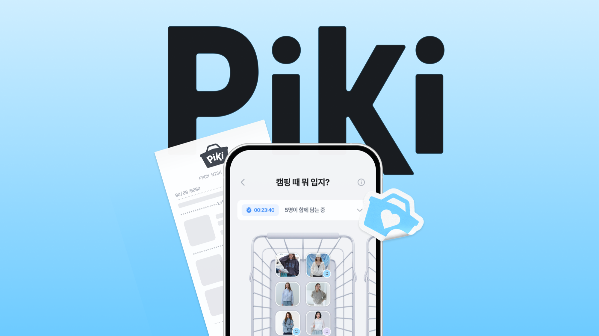

---

## 프로젝트 개요

| 구분 | 내용 |
|---|---|
| 프로젝트명 | PiKi (피키) |
| 프로젝트 형태 | 위시리스트 비교·결정 앱 (iOS · Android · Web) |
| 주요 사용자 | 위시리스트와 장바구니는 가득하지만, 고르지 못해 구매를 계속 미루는 20~30대 모바일 쇼핑 사용자 |
| 핵심 목표 | 쌓아두기만 하던 위시템을 비교 가능한 후보로 바꾸고, 혼자서도 함께여도 결정을 끝낼 수 있게 한다 |
| 서비스 현황 | App Store · Google Play 출시 |

---

## 프로젝트 배경

국내 이커머스의 평균 구매 전환율은 **1.33%** 입니다. 100명이 상품을 봐도 실제로 사는 사람은 1명 남짓이고, 장바구니에 담은 사람도 **10명 중 7~8명**은 결국 구매하지 않습니다.

빅인사이트 이커머스 전환 리포트 · Baymard Institute

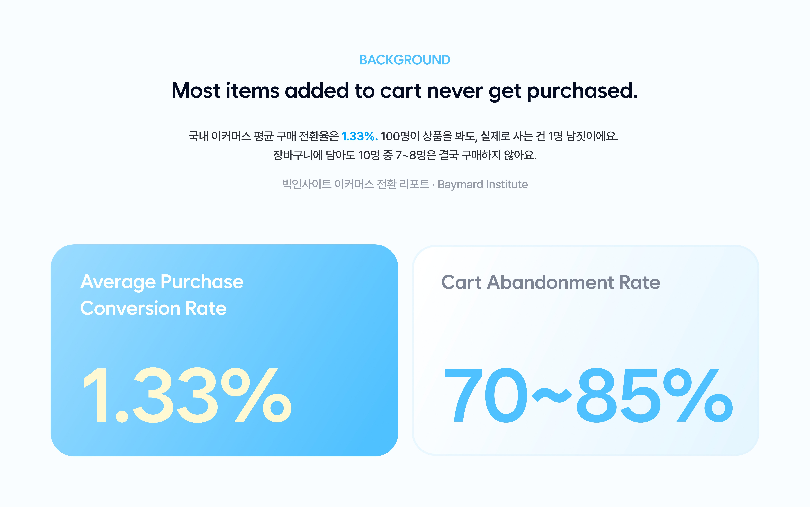

사고 싶은 게 없어서가 아닙니다. 쇼핑몰마다 위시리스트가 따로 쌓이고, 후보가 늘어날수록 무엇을 먼저 살지 고르는 일이 피로해져 결정을 미루게 됩니다.

위시리스트 앱 10개를 살펴보니, 대부분 상품을 **모아두거나(Archive)**, **선물하거나(Gifting)**, **가격을 알려주는(Alert)** 데 머물러 있었습니다. 모은 다음 **무엇을 고를지 결정하는 단계**를 풀어주는 서비스는 없었습니다.

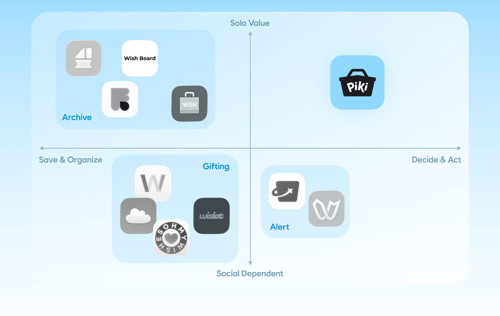

PiKi 는 그 결정 단계에 집중합니다. 혼자서도 결정을 끝낼 수 있고, 친구를 초대하면 게임처럼 함께 고를 수도 있게 방향을 잡았습니다.

---

## 서비스 소개

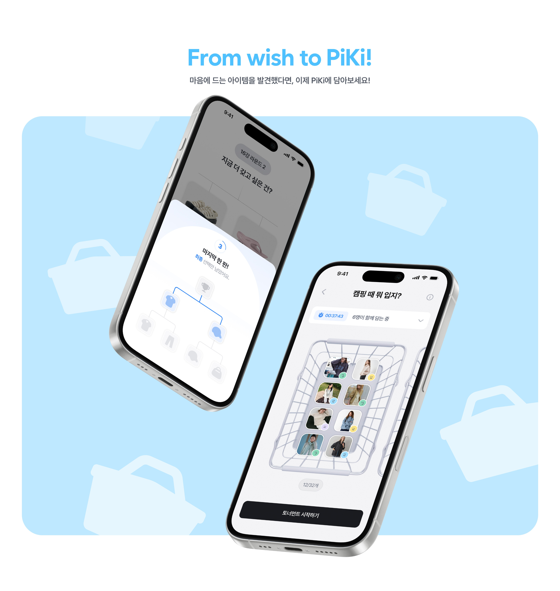

**어디서 발견했든, 한곳에 모읍니다.**

무신사, 29CM, 지그재그, W컨셉, 유니클로 등 어느 쇼핑몰에서 발견한 상품이든 링크 붙여넣기, 캡처 이미지, 공유하기로 PiKi 바구니에 바로 담을 수 있습니다. 상품명·가격·이미지는 자동으로 채워집니다.

**어떤 선택은 함께라서 더 쉽습니다.**

친구를 바구니에 초대해 후보를 함께 모을 수 있습니다. 초대받은 친구는 링크나 초대 코드만으로 회원가입 없이 바로 참여해 상품을 담습니다. 누가 어떤 상품을 담았는지는 프로필로 구분됩니다.

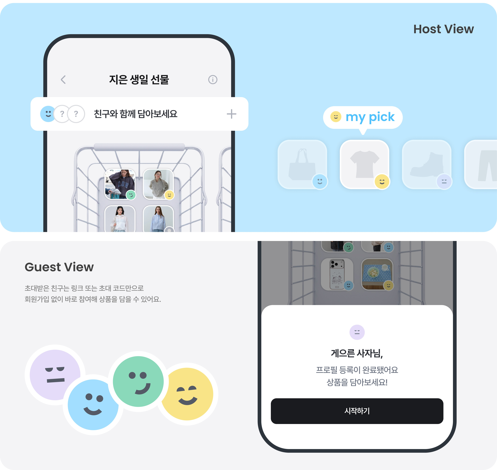

**비교하기 좋은 대진표를 만들어 줍니다.**

바구니에 후보가 모이면 토너먼트를 시작합니다. 비슷한 가격대의 상품끼리 맞붙도록 대진표를 짜서, 가격이 아니라 취향으로 비교하게 합니다.

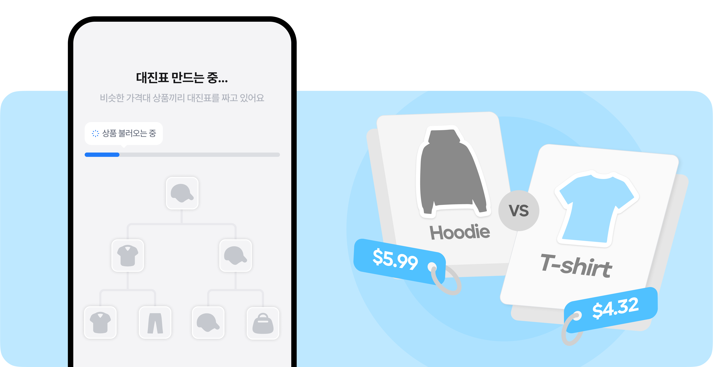

**두 개씩 고르다 보면 하나가 남습니다.**

한 번에 하나씩, 둘 중 더 갖고 싶은 것을 고르면 됩니다. 라운드를 거칠수록 후보가 줄고, 마지막에 남은 하나가 지금 가장 갖고 싶은 상품입니다.

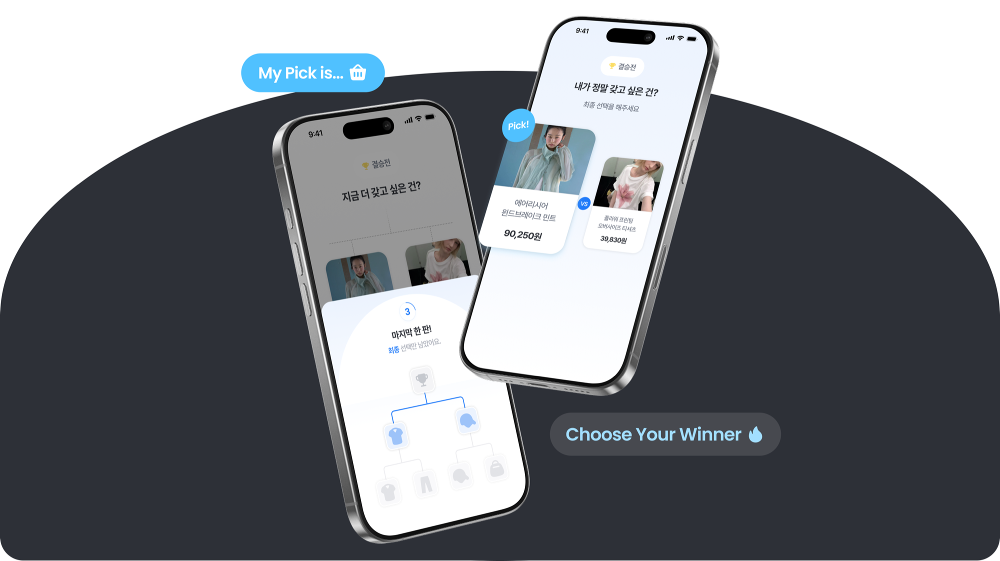

**결과는 영수증으로 남깁니다.**

토너먼트 결과는 영수증 한 장으로 정리됩니다. 함께 고른 경우 친구들의 선택을 합친 그룹 결과를 보여주고, 이미지로 저장하거나 공유할 수 있습니다.

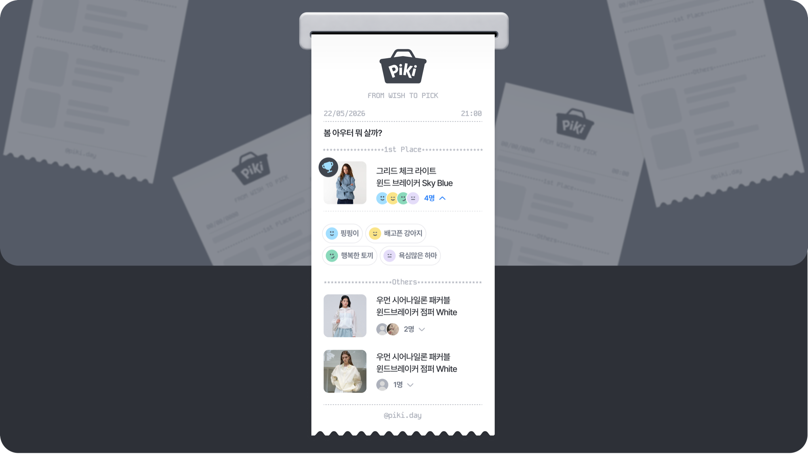

---

## 서비스 이용 흐름

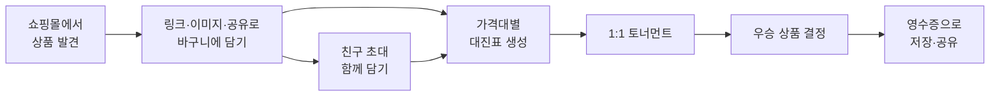

---

## 주요 화면

**어디서든 바구니에 담기**

| 링크로 담기 | 이미지로 담기 | 공유로 담기 |
|:---:|:---:|:---:|
| 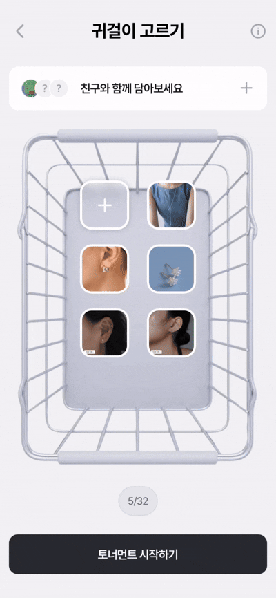 | 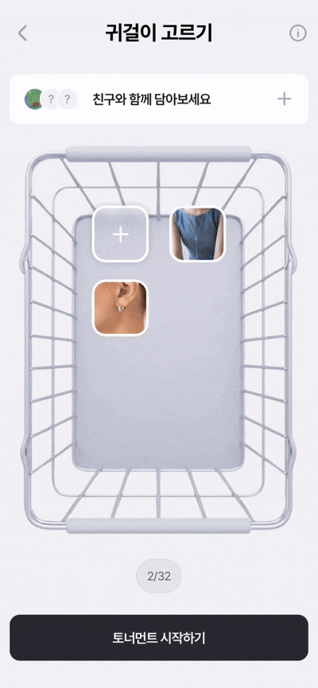 | 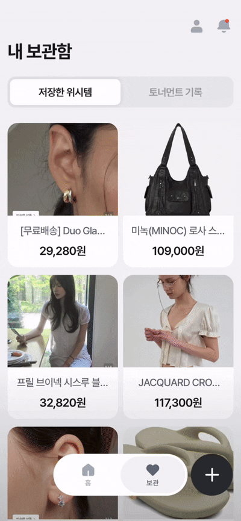 |

---

## 시스템 구조

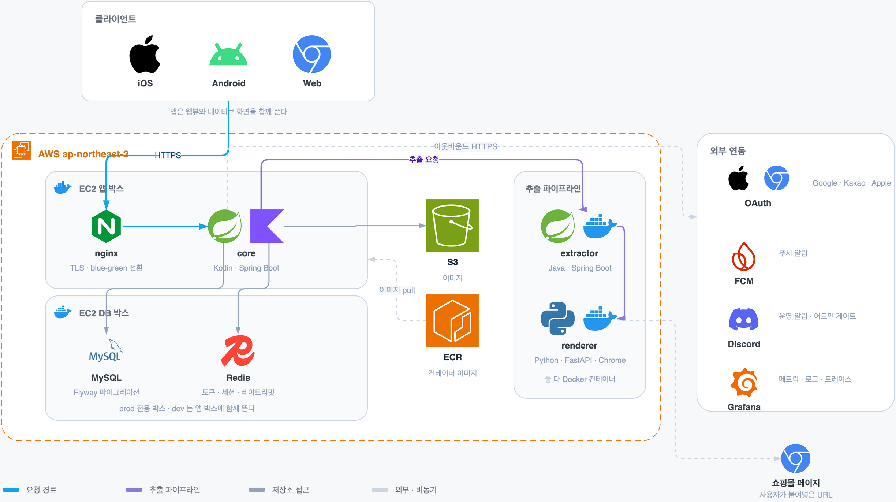

**모든 요청은 API 서버 하나를 거칩니다.**

iOS · Android · Web 의 요청은 AWS 위의 API 서버(core)로 모입니다. API 서버가 위시 · 토너먼트 · 사용자 데이터를 관리하고, 소셜 로그인(Google · Kakao · Apple)과 푸시 알림을 연결합니다.

**상품 정보는 추출 서버가 따로 뽑아옵니다.**

사용자가 링크나 캡처 이미지로 상품을 담으면, API 서버가 추출 서버(extractor)에 요청합니다. 추출 서버는 쇼핑몰 페이지에서 상품명 · 가격 · 이미지를 뽑아내고, 구조화된 정보가 부족하면 LLM 으로 보완합니다. 자바스크립트로 그려지는 쇼핑몰 페이지는 렌더링 서버(renderer)가 실제 브라우저로 열어 넘겨줍니다.

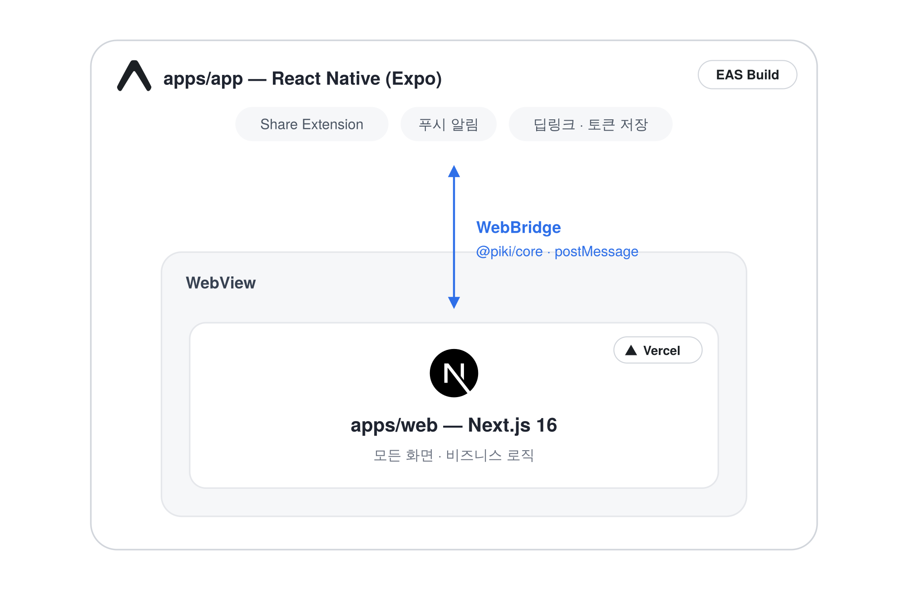

**앱은 웹 화면을 감싸고, 네이티브 기능만 맡습니다.**

화면과 비즈니스 로직은 웹(Next.js)에 모으고, 앱은 웹뷰로 그 화면을 띄웁니다. 공유하기로 담기, 푸시 알림, 딥링크, 로그인 토큰 저장처럼 기기 기능이 필요한 일만 앱이 처리하고, 웹과 앱은 메시지(WebBridge)로 주고받습니다. 덕분에 대부분의 변경은 스토어 심사 없이 웹 배포만으로 바로 반영됩니다.

---

## 레포지토리

| 레포 | 무엇을 하나 |
|---|---|
| [**client**](https://github.com/TeamPiKi/client) | iOS · Android 앱과 웹. 앱이 웹뷰로 웹 화면을 감싸는 구조 |
| [**core**](https://github.com/TeamPiKi/core) | API 서버 · 위시 · 바구니 · 토너먼트 · 사용자 · 알림 |
| [**extractor**](https://github.com/TeamPiKi/extractor) | 쇼핑몰 링크와 캡처 이미지에서 상품명·가격·이미지를 뽑는 추출 서버 |
| [**infra**](https://github.com/TeamPiKi/infra) | 레포 공통 규약 · 배포 설정 |

---

## 팀 소개

<table>
  <thead>
    <tr>
      <th align="center" colspan="4">Client</th>
    </tr>
  </thead>
  <tbody>
    <tr>
      <td align="center" width="25%"></td>
      <td align="center" width="25%"></td>
      <td align="center" width="25%">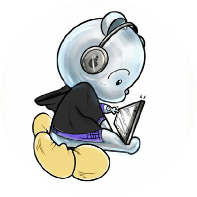</td>
      <td align="center" width="25%"></td>
    </tr>
    <tr>
      <td align="center"><b>정선아</b></td>
      <td align="center"><b>박소영</b></td>
      <td align="center"><b>강하은</b></td>
      <td align="center"><b>조영찬</b></td>
    </tr>
    <tr>
      <td align="center"><a href="https://github.com/iodio89">@iodio89</a></td>
      <td align="center"><a href="https://github.com/soyeong0115">@soyeong0115</a></td>
      <td align="center"><a href="https://github.com/kanghaeun">@kanghaeun</a></td>
      <td align="center"><a href="https://github.com/ychany">@ychany</a></td>
    </tr>
  </tbody>
  <thead>
    <tr>
      <th align="center" colspan="4">Server</th>
    </tr>
  </thead>
  <tbody>
    <tr>
      <td align="center" width="25%">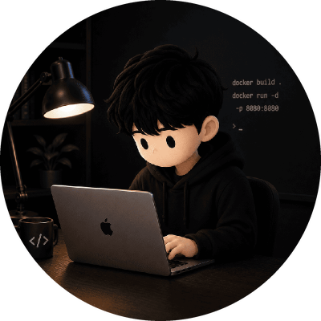</td>
      <td align="center" width="25%">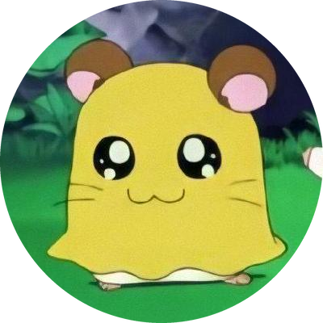</td>
      <td align="center" width="25%">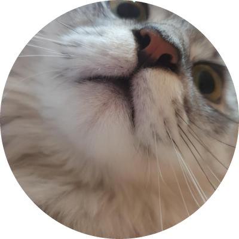</td>
      <td width="25%"></td>
    </tr>
    <tr>
      <td align="center"><b>박세빈</b></td>
      <td align="center"><b>박은지</b></td>
      <td align="center"><b>조재중</b></td>
      <td></td>
    </tr>
    <tr>
      <td align="center"><a href="https://github.com/sevineleven">@sevineleven</a></td>
      <td align="center"><a href="https://github.com/1o18z">@1o18z</a></td>
      <td align="center"><a href="https://github.com/m-a-king">@m-a-king</a></td>
      <td></td>
    </tr>
  </tbody>
  <thead>
    <tr>
      <th align="center" colspan="4">Design</th>
    </tr>
  </thead>
  <tbody>
    <tr>
      <td align="center" width="25%">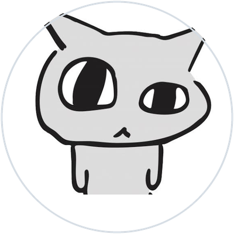</td>
      <td align="center" width="25%">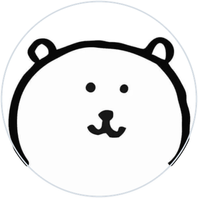</td>
      <td align="center" width="25%">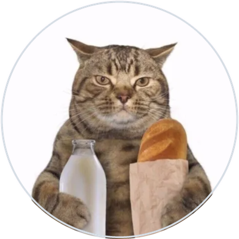</td>
      <td width="25%"></td>
    </tr>
    <tr>
      <td align="center"><b>육예진</b></td>
      <td align="center"><b>이예빈</b></td>
      <td align="center"><b>정의연</b></td>
      <td></td>
    </tr>
    <tr>
      <td align="center"><a href="https://www.behance.net/imyj980220af40">Behance</a></td>
      <td align="center"><a href="https://www.behance.net/bad7ac99">Behance</a></td>
      <td align="center"><a href="https://www.behance.net/euiyeonjeong">Behance</a></td>
      <td></td>
    </tr>
  </tbody>
</table>
